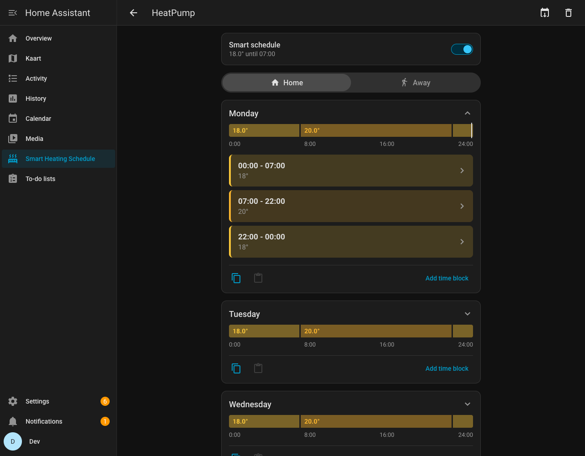
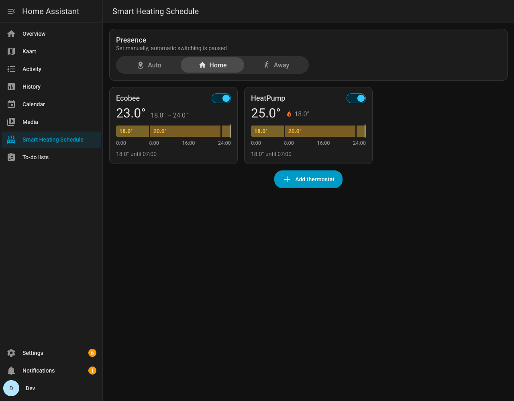
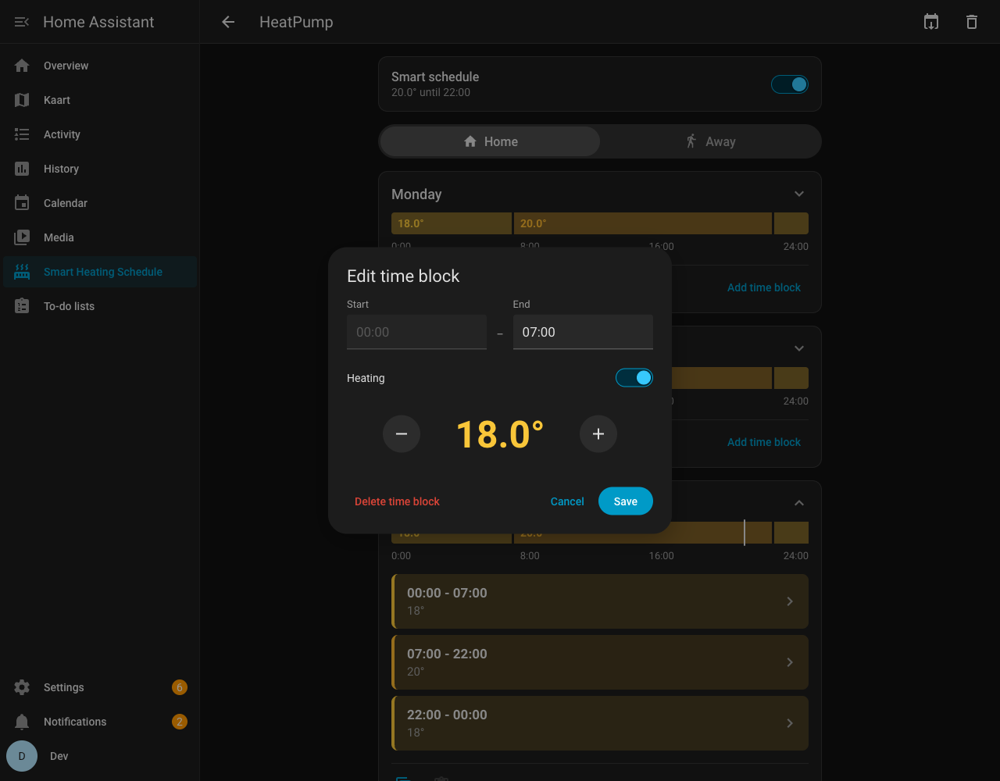
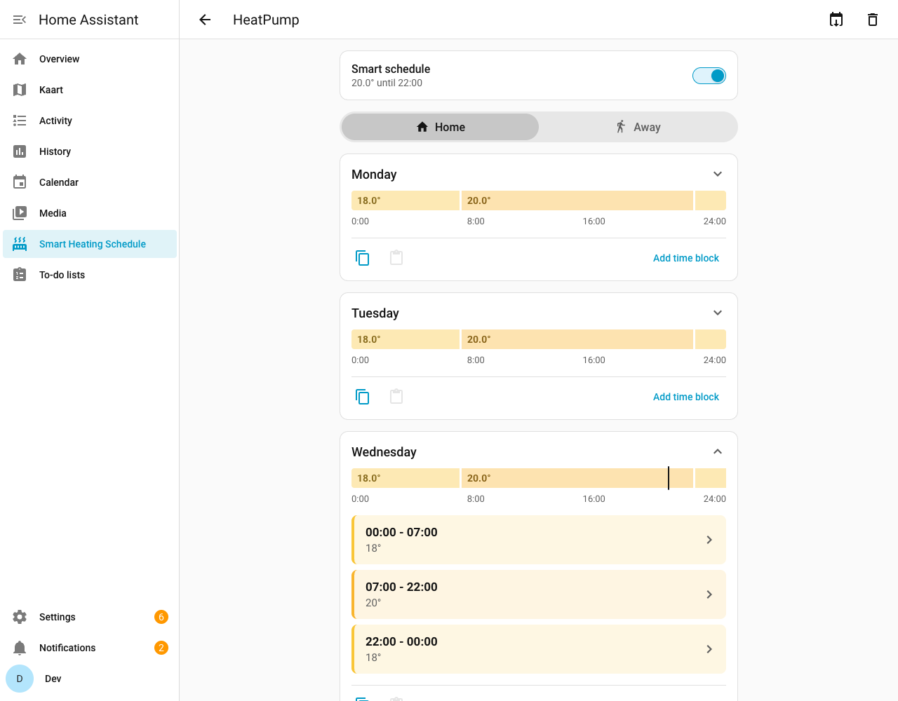

# Smart Heating Schedule

Weekly heating schedules for **any thermostat** in Home Assistant, edited on a timeline inspired by Tado's Smart Schedule.



The integration adds a **Smart Heating Schedule** page to the sidebar. On it you can:

- see every thermostat at a glance: its room, current temperature and today's schedule
- give each thermostat a weekly **Home** and **Away** schedule
- see every day of the week (Monday to Sunday) as a coloured timeline, which expands into its time blocks
- add, edit and delete time blocks on a 15-minute grid. Overlapping blocks are shortened or replaced, as in Tado.
- set a block to a temperature or to **Off** (frost protection on devices that can't turn off)
- copy one day and paste it onto another, or copy a whole schedule to other rooms
- switch Home and Away automatically from presence (`zone.home` by default), or set it by hand
- see when someone changed a thermostat by hand, and go back to the schedule with one tap (**Restore schedule**)

It is vendor agnostic: it works with Tado, Netatmo, Zigbee/Z-Wave radiator valves, `generic_thermostat`, Ecobee, Nest and any other `climate` entity. Celsius and Fahrenheit both work, and the UI follows your Home Assistant theme, language (English, German, Dutch, French, Spanish, Italian, Polish, Portuguese, Russian, Turkish and Simplified Chinese included) and 12/24-hour setting.

| Overview | Edit a time block | Light theme |
| --- | --- | --- |
|  |  |  |

## Installation

### HACS (recommended)

1. In HACS, open the menu (⋮) → **Custom repositories**.
2. Add `https://github.com/talhaucar/smart-heating-schedule` with type **Integration**.
3. Install **Smart Heating Schedule** and restart Home Assistant.
4. Go to **Settings → Devices & services → Add integration** and pick **Smart Heating Schedule**.

### Manual

Copy `custom_components/smart_heating_schedule` into your `config/custom_components` folder, restart, and add the integration as above.

Requires Home Assistant 2026.3 or newer.

## Using it

1. Open **Smart Heating Schedule** in the sidebar and choose **Add thermostat**. The thermostat starts with a default schedule: Home 18° / 20° from 07:00 / 18° from 22:00, and Away 16° all day (64° / 68° / 64° and 61° °F).
2. Tap a day to see its time blocks. Tap a block to change its times or temperature, or use **Add time block**.
3. Use the **Home | Away** switch at the top to edit the away schedule.
4. To give several days the same schedule, use the copy button on one day and the paste button on the others.

Changes are saved immediately, like in the Tado app.

### How the schedule is applied

- A thermostat only gets a command **when the wanted temperature changes**: at a block boundary, when Home/Away switches, or when you edit the current block. Back-to-back blocks with the same temperature (including across midnight) don't trigger anything. This keeps the number of commands low, which matters for cloud APIs with rate limits (such as Tado's).
- **A manual change on the thermostat holds until the next block**, the same as Tado's "until next time block". The panel then shows **Restore schedule** on that thermostat to go back to the schedule right away; in automations, use the action `smart_heating_schedule.resume_schedule`. The scheduled temperature sensor has an `overridden` attribute that is true while a manual change is active.
- After a restart, a block is only applied again if it isn't the block that was last applied, so restarts don't undo manual changes.
- If a thermostat is unavailable, the block is applied as soon as it comes back. If a command fails, it is retried after 5 minutes and the error is shown in the panel.

How each thermostat is handled depends on what it supports:

| Device supports | What is sent |
| --- | --- |
| A single setpoint | `climate.set_temperature` with `temperature` |
| Only a low/high range (`heat_cool`) | `target_temp_low` = the scheduled temperature; `target_temp_high` is kept, or raised if needed |
| Device is off, in `auto` (its own schedule) or cooling | The `hvac_mode` is switched to `heat` (or `heat_cool`, or `auto` if that's all it has) |
| An **Off** block | `hvac_mode: off`, or the device's minimum temperature if it can't turn off |

Temperatures are clamped to each device's `min_temp` / `max_temp`.

### Home and Away

The **Presence** control at the top of the panel, also available as the entity `select.smart_heating_schedule_presence_mode`, has three modes:

- **Auto**: follows the presence entity. The default is `zone.home`, which counts as away when nobody is in it. You can choose another entity under **Settings → Devices & services → Smart Heating Schedule → Configure**:
  - a `person`, `device_tracker` or `group`: away when it isn't `home`
  - a `binary_sensor` or `input_boolean`: away when it is `off`
- **Home** / **Away**: forces one profile, like Tado's manual Home/Away.

Presence changes are debounced by a few seconds. If presence is unknown, the home schedule is used.

### Devices with their own built-in schedule

Many thermostats also run a schedule internally. Make sure it doesn't fight this one:

- **Tado**: see [Tado](#tado) below.
- **Netatmo, Honeywell, Ecobee and similar**: commands from Home Assistant are usually temporary holds. Check the device's "hold until" setting, or use a flat schedule in the vendor app.
- **Radiator valves with a local schedule (Z2M/ZHA)**: switch the valve to manual mode or disable its internal schedule.

#### Tado

When Home Assistant sets a temperature, Tado treats it as a **manual change** on top of the schedule in the Tado app. By default Tado ends a manual change according to each room's setting in the Tado app. If that is "until the next time block", Tado goes back to its own app schedule at its own block times, and overrules this schedule until its next block.

Make manual changes last until the next command, in one of these two ways:

- **In Home Assistant (recommended, covers all rooms at once):**
  1. Go to **Settings → Devices & services → Tado**.
  2. Click **Configure** (the gear icon next to your Tado account).
  3. Set the **fallback mode** to **`MANUAL`** ("Don't change until you cancel") and submit. No restart is needed.
- **In the Tado app (per room):** leave the fallback mode in Home Assistant on `TADO_DEFAULT`, which follows the app. Then in the Tado app open **Settings → Rooms & Devices**, pick a room, and set its manual control duration to **until you cancel** (not "until the next automatic change" or a timer). Repeat for every scheduled room. The exact menu names differ a little between app versions.

Afterwards the Tado app shows these rooms as manually controlled. That is expected: this integration is now their schedule, and the schedule in the Tado app is no longer used for them.

The Tado API has a daily request quota. This integration only sends a command when the wanted temperature changes, so it uses very few requests.

## Entities

For each scheduled thermostat (shown on the thermostat's own device page):

| Entity | Description |
| --- | --- |
| `switch.<room>_smart_schedule` | Turns the schedule on or off |
| `sensor.<room>_scheduled_temperature` | The temperature the schedule wants now (unknown during an Off block). Attributes: `profile`, `block_start`, `block_end`, `next_temperature`, `heating_off`, `pending`, `overridden` (changed by hand), `last_error` |

Global entities, on the *Smart Heating Schedule* service device:

| Entity | Description |
| --- | --- |
| `select.smart_heating_schedule_presence_mode` | `auto`, `home` or `away` |
| `sensor.smart_heating_schedule_active_schedule` | `home` or `away`: the profile in use |

Entity IDs follow your Home Assistant language, so they may be translated.

## Actions

```yaml
# Re-apply the current block now, undoing manual changes
action: smart_heating_schedule.resume_schedule
target:
  entity_id: climate.bedroom

# Read a schedule (e.g. to copy it into set_schedule)
action: smart_heating_schedule.get_schedule
data:
  entity_id: climate.bedroom
response_variable: schedule

# Write a schedule
action: smart_heating_schedule.set_schedule
data:
  entity_id: climate.bedroom
  enabled: true
  home:
    days:
      mon:
        - { start: "00:00", temperature: 18 }
        - { start: "07:00", temperature: 20 }
        - { start: "22:00", temperature: 18 }
      tue: [...]
      wed: [...]
      thu: [...]
      fri: [...]
      sat: [...]
      sun: [...]
```

All seven days (`mon` to `sun`) are required. Each day is a list of blocks. The first block starts at `00:00`, each block runs until the next one starts (the last one until midnight), starts fall on a 15-minute grid, and `temperature: null` means Off. Temperatures are in your Home Assistant unit system.

## Storage

Schedules are stored in `.storage/smart_heating_schedule`, so Home Assistant backups include them. If you change the unit system between °C and °F, stored schedules are converted.

## Development

```bash
# Backend
python3 -m venv .venv && .venv/bin/pip install -r requirements_test.txt
.venv/bin/pip install home-assistant-frontend   # version matching homeassistant
.venv/bin/pytest
.venv/bin/ruff check custom_components tests

# Frontend (TypeScript + Lit, bundled into custom_components/.../frontend)
cd frontend && npm ci
npm run lint && npm test && npm run build
```

The built bundle `custom_components/smart_heating_schedule/frontend/smart-heating-schedule-panel.js` is committed, so HACS users don't need Node. CI fails if it is out of date.

### Translations

The panel's texts are in `frontend/src/translations/<language>.ts`, and the setup screens, entities and actions are in `custom_components/smart_heating_schedule/translations/<language>.json`. English is the source. Every language must have every key with the same `{placeholders}`: the type check and tests on both sides fail otherwise. To add a language, copy `en.ts` and `en.json`, translate them, and register the new file in `frontend/src/localize.ts`. Corrections from native speakers are very welcome.

### Releasing

1. Bump `version` in `custom_components/smart_heating_schedule/manifest.json`.
2. Run `npm run build` in `frontend/` and commit.
3. Create a GitHub release with tag `vX.Y.Z`. HACS offers the latest releases to users.

To get listed in the HACS default store, check that the *Validate* workflow passes. The repository needs a description and topics, such as `home-assistant`, `hacs`, `heating` and `schedule`. Then submit it as described at <https://hacs.xyz/docs/publish/include>.

## License

MIT

This project is not affiliated with or endorsed by tado GmbH. tado° is a trademark of tado GmbH.
